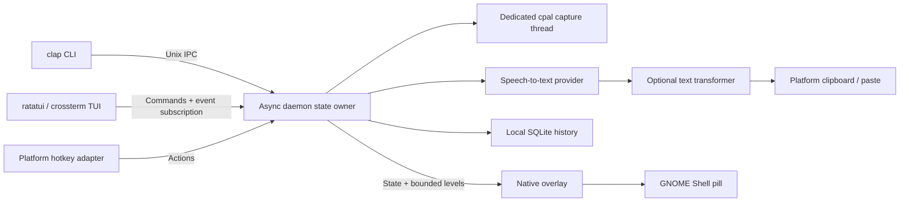

# Architecture

Revision: 2026-10-02. The integrated Rust workspace contains `xflow-core`, `xflow-providers`, `xflow-platform`, and `xflow-app`; the app crate builds the `xflow` CLI/TUI and `xflowd` daemon. The current design distinguishes implemented behavior from proposed extensions; desktop acceptance remains incomplete. Research supporting these choices is in [docs/RESEARCH.md](docs/RESEARCH.md), and release stages are in [ROADMAP.md](ROADMAP.md).

## Process and crate boundaries

The CLI and TUI are clients and consume event-driven state updates; they do not poll the daemon for UI state. Closing either must not terminate an active daemon. The daemon owns session state, capture lifecycle and finalized output. Heavy optional engines and compositor rendering must not enter the core contract crate. A native Shell extension is a small GNOME-specific renderer, not a WebView. The CLI/TUI and integrations are development-slice work, not evidence of a validated desktop release.

| Crate | Responsibility |
| --- | --- |
| `xflow-core` | Shared serializable state/config/IPC contracts and platform/provider traits |
| `xflow-providers` | WAV encoding, batch STT adapters, optional text cleanup and credential resolution; live credentials unvalidated |
| `xflow-platform` | cpal capture, desktop copy/paste and GNOME integration; physical-device path unvalidated |
| `xflow-app` | Daemon state owner/storage/IPC plus `xflow` CLI/TUI and `xflowd` daemon binaries; UI state updates are event-driven |

No Electron, embedded browser or default local model runtime. Reuse native capture/IPC/overlay ideas from whisrs while keeping this implementation independent; any future source reuse requires the upstream MIT notices.

## Existing trait contracts

The canonical declarations are in `apps/cli/crates/xflow-core/src/lib.rs`:

| Contract | Meaning and boundary |
| --- | --- |
| `SpeechToText` | `name`, `model`, `warm`, `supports_streaming`, async `transcribe(AudioClip, TranscriptionOptions) -> Transcript`; raw input is interleaved normalized f32 PCM with explicit sample rate/channels |
| `StreamingSpeechSession` | `send_audio`, `next_partial`, consuming `finish` and `cancel`; future streaming must return a finalized transcript before insertion |
| `TextTransformer` | Independent optional `transform(TransformRequest) -> String`; no credentials or STT implementation required by this trait |
| `AudioCapture` | Async `start`, `stop -> AudioClip`, `cancel`, `finished` and cheap latest `level`; capture ownership remains on the dedicated thread |
| `Desktop` | `context -> AppContext`, `inject(text, target) -> InjectionOutcome`, `copy`, `selection`; distinguishes `Pasted`, `Uncertain`, `Typed` and `ClipboardOnly` |
| `GlobalHotkeys` | Event-based `next_action -> HotkeyAction`; actions are start/stop/toggle/cancel/paste-last |
| `Overlay` | `update(DesktopEvent)` with state, normalized level, mode and optional message |

On macOS a passive CGEventTap has its own CFRunLoop thread and feeds the pure
timestamp gesture machine; the daemon consumes `GlobalHotkeys` actions directly.
Only a pending lone tap creates a one-shot timer. The recording pill runs in a
transient sibling `xflow overlay-pill` helper, with AppKit loaded dynamically in
that helper only. Its bounded stdin contains state/level, never transcript text.
Linux retains the GNOME extension and its existing D-Bus path.

`AppContext` contains optional app/window identifiers and selected text, plus a default-false `terminal_input` hint for focused integrated terminals. The hint never establishes bracketed-paste capability. An empty context is an honest capability limitation, not proof of context discovery. The MVP's combined `Desktop` trait is intentionally small; split clipboard/context/injection interfaces only when a real second implementation requires independent ownership.

`supports_streaming` currently distinguishes batch from streaming, but cannot on its own expose language, vocabulary, selection, hotkey-release or overlay support. Future adapters should add tested capability descriptions and typed unsupported/permission errors. Until then, diagnostics and returned errors must make missing capability visible; do not set a flag just because a protocol-shaped method exists.

## Daemon state and cancellation

States are `Idle`, `Listening`, `Processing`, `Success`, `Error`. The single state owner serializes commands and session completions. Capture and HTTP work run outside command dispatch so status/cancel stay responsive. A session identity or equivalent stale-result guard ensures that completion from a cancelled recording cannot affect a newer session.

Start creates one capture session. Stop takes ownership of its finalized clip and starts transcription. Toggle maps to start/stop by state; conflicting starts during processing report busy. Cancel aborts the active job, stops capture, and advances a generation guard that rejects stale completions. If the transcript was already finalized and saved, cancel cannot undo its history entry or `last` recovery text; queued cancellation is processed before injection starts when possible. `clear-history` cancels active work, clears the database and clears `last`. Daemon `Success`/`Error` persists until a new recording or cancel; the GNOME overlay independently hides success/error after 1.5/4 seconds.

Silent/empty recordings produce no upload. The lightweight energy gate is not a neural speech classifier: quiet speech and noise still require hardware evaluation. Maximum duration and a hard sample/memory budget cap capture. Callback work must avoid blocking operations and must surface overflow/device errors instead of returning plausible but truncated audio.

Later streaming uses bounded audio queues and separates partial preview from committed text. It does not type unstable provider hypotheses into another app. Completed batch upload is never described as realtime streaming.

## IPC and UI events

The app IPC path uses event-driven subscription for UI state, rather than polling. Unix domain IPC is used on Linux/macOS. A future Windows transport may use a named pipe with the same serialized request/response contracts. `xflow-core::ipc` includes status/start/stop/toggle/cancel, last/copy/paste-last, paged/searchable history, history get/delete/copy/paste, clear-history, stats, reload, subscribe, allow (macOS permission requests) and shutdown requests, with a 64 KiB maximum message contract. The transport implementation must enforce that cap before allocating unbounded input and limit slow clients.

Place the socket in a user-private runtime directory and restrict permissions. A fallback directory must be private and validate ownership; never trust a publicly writable predictable socket path. Reject malformed/oversized requests and bound read/write time. Subscription clients get current state then events without polling. Slow or disconnected subscribers must not block audio or command handling.

Audio remains inside the capture/provider pipeline. Normal UI events carry state and level, not raw audio. Transcript-bearing responses are explicit local requests or controlled finalized output; logs must not duplicate their payloads. Coalesce waveform updates to a small active cadence and stop publishing periodic levels while idle.

## Provider transport and secret boundaries

The integrated catalog includes ten cloud batch STT adapters plus custom/local servers (see [provider contracts](apps/cli/crates/xflow-providers/README.md)). Groq uses multipart WAV upload. OpenRouter uses a distinct JSON/base64 `input_audio` request; the [official reference](https://openrouter.ai/docs/api/api-reference/stt/create-transcription) is the contract, not assumptions based on an OpenAI-looking URL. A custom OpenAI-compatible REST adapter accepts a full transcription endpoint; it is not arbitrary-protocol support. Language/vocabulary fields are only sent when supported. Shipped domain terms (`xflow_core::hints`, `[vocab]`, `stt.domain_hints`) are hint-only: a ~3k-term lexicon built by `scripts/lexicon/build.py` is embedded read-only (~38 KB). At key-down, off the actor, the context job picks up to 100 from local signals (the focused app's groups; terms from recent deliveries, kept in memory and seeded once from history; sections the user's dictionary words and the window title point at, with no title word ever sent). Uploads take the last pick and never wait for the current read; the provider appends them after the user's words within its budget; they never rewrite text. Model-dependent limits and rejected fields need clear user diagnostics.

Reuse HTTP clients across sessions, apply deadlines and bound response bodies. Reject empty/malformed successful responses. Do not return raw server bodies or request URLs containing credentials in logs. An explicit `stt.fallback` opts in to one backup catalog provider with its own stored key. Connection/TLS errors, upload/read interruptions, 408, 429, 5xx and deadlines advance from the primary to the backup once; primary auth/caller errors never switch. The backup goes first during a 60-second primary breaker, and any backup error then probes the primary once. Batch attempts use an audio-length deadline; async AssemblyAI retains its configured timeout. A missing backup key warns and runs primary-only; explicit validation/saves still require the key. No parallel requests or background retries; abandoned requests may still be billed. Without a backup, the existing timeout and retry policy is unchanged.

Configuration is TOML with strict field validation. Secrets are resolved through configured environment references, then xflow's encrypted keystore (`docs/credentials.md`); they are not TOML values. Local endpoints may require no credentials, but cloud adapters must reject missing keys before recording/upload when possible. Optional LLM cleanup is independently configured; raw bypasses it. Cleanup failure should preserve usable STT output and expose that cleanup failed rather than silently discard dictation.

Offline rejects non-loopback STT and cleanup endpoints before network access. Compatible local servers and the whisper.cpp server protocol are implemented; users manage the server and model themselves. Managed model downloads and sidecar lifecycle remain future work. A local server's own network behavior is outside this guard. A WebSocket URL alone cannot implement arbitrary streaming: each protocol needs framing, finalization, cancellation and fixture tests.

## Storage and retention

SQLite WAL stores bounded local transcript history. The default retention is 500 entries; configuration permits up to 100,000. Queries apply limits before returning rows; preferences/configuration remain local. History schema v2 adds model/raw text/app/language/duration/latency/mode metadata. Dictionary, snippets and per-app styles live in validated TOML and run through the deterministic text pipeline; they are not SQLite placeholder tables.

History-disabled sessions must not write transcript text, although copy-last may retain a transient in-memory result for recovery. Clearing history must also be clear about transient last-result state and backups. Private directory/file permissions protect against other users, not arbitrary processes running under the same account. No audio files by default (opt-in `privacy.keep_failed_audio` keeps one failed dictation, private, ≤24 h, for retry), no telemetry sender, and no secret/transcript content in routine logging.

SQLite writes are serialized and bounded; blocking database operations stay outside latency-sensitive capture callbacks. Transactional history migration and atomic comment-preserving settings writes are implemented. Encryption-at-rest is not implied by a local SQLite file.

## Platform strategy and truthful fallback

| Platform/session | Initial approach | Release status / later work |
| --- | --- | --- |
| Ubuntu GNOME Wayland | cpal audio; session-bus bridge + native Shell pill; toggle/hold/smart shortcuts; native Shell injection with guarded utility fallbacks | Primary integration target; physical microphone, live provider credentials, actual paste and input-device/uinput operation require desktop acceptance; physical hold/smart shortcut behavior remains an acceptance gate |
| GNOME X11 | Same core; X11 utilities can provide paste | Basic adapter path is not tested-desktop certification; dedicated hotkey/overlay acceptance later |
| Fedora GNOME | Reuse GNOME design, verify packages, security policy and Shell compatibility | Later distro gate |
| wlroots compositors | Compositor bindings; native layer-shell overlay; virtual-keyboard protocol when exposed, uinput/paste fallback | Separate adapter and verification later |
| KDE Wayland | Probe native/portal shortcut and context capability; KDE-specific overlay | Separate adapter and verification later |
| Generic X11 | X11 shortcut/context/overlay adapter; clipboard + synthetic key fallback | Dedicated integration later |
| macOS | Accessibility focus/selection, CGEvent input, native nonactivating panel, Keychain | Design only; permission and signing/package validation later |
| Windows | UI Automation/SendInput, native overlay, credential manager, named-pipe IPC | Architectural possibility; no shipped support claim |

The [GlobalShortcuts portal](https://flatpak.github.io/xdg-desktop-portal/docs/doc-org.freedesktop.portal.GlobalShortcuts.html) specifies activation/release signals, but every runtime must probe actual backend support. The GNOME extension implements release-aware hold/smart shortcuts alongside toggle; physical desktop validation remains pending. Direct uinput/evdev permissions should be minimal and explicit; the daemon must not run as root to obtain them. GNOME prefers the native Shell virtual keyboard; the fallback invokes `ydotool` where configured; direct uinput operation and actual destination delivery remain unvalidated. `ydotool` and `xdotool` success indicates an attempted key action, not a verified editable target.

Clipboard transport overwrites current content. Optional restoration preserves prior text only when the clipboard still holds the injected text; full MIME restoration remains unsupported. Missing paste capability produces clipboard-only recovery rather than a false pasted result. GNOME app/window identity drives guarded injection and per-app styles. Unknown or changed focus yields clipboard-only recovery; dispatch is not proof that the destination accepted text.

GNOME overlay rendering must not become the active window. Hide it when idle and disconnect D-Bus signals/timers on extension disable. Implemented position/size/opacity/waveform/animation preferences are bounded in GSettings; unsupported desktops retain CLI/TUI operation. Shell renderer CPU and memory are measured separately from daemon RSS.

## Auto-learning dictionary

`[dictionary] auto_learn = true` (default). Two inputs share one pure core (`xflow_core::learn`):

1. **Corrected paste (macOS).** `Desktop::inject_observed` pins the exact focused element and window, arms an AXObserver on its own thread and takes a bounded read before the paste keys, so the `Receipt` (the delivered text plus 16 characters of context on each side) is built from the selection it will replace, never by searching afterwards, and an edit right after the paste is still announced. Every read goes through `xflow_core::read_field`: a fresh guard (not secure or protected, still focused, same window) before each native call, ≤20,000 UTF-16 units via `AXStringForRange`, no `AXValue` copy, nothing kept if the field or its notification generation moved. `BoundedReader` runs one read at a time off the runtime; `FieldWatch::stop` closes the gate, waits out a call already running (it cannot be preempted and its result is discarded) and joins the observer. A focus notification is a prompt: the callback checks whether the pinned element still holds focus, and a real departure, a destroyed element or a lost notification latches the gate for good. `watch_pinned` saves about 2 s after the corrected words stop changing and the caret has left them (`learn::caret_on`; 4 s under the caret unless the word is shorter than what it corrects, which may be a partial `Veronic`), and goes on for further fixes; a send, a focus change, the next dictation or 60 s finish it. A focus, field or app change saves nothing while the caret is on a corrected word touched in the last 500 ms or shorter than what it corrects (`partial`), so a genuine shortening left that way is missed; a send or the next dictation still commits it. A field that empties, or a retype's read unchanged by a further notification, is a new message. Cancel and a save settle on one atomic without either waiting (`SAVE_OPEN`).
2. **History edit (all platforms).** `history_update` (`xflow history edit`, or History → "Correct this transcript" in the TUI) saves the corrected transcript and passes old/new text to the same function.

`review()` runs a case-insensitive word-level LCS (nothing is learned unless at least half the original words survive) and keeps edits of 1-3 words that replace 1-3 plain words (four for a term of one or two) with a close spelling (at most a third of the letters changed) or the same consonant skeleton (`cooper netties` → `Kubernetes`). A short text where a run of words was respelled passes the similarity test on its letters instead (bounded: at most 40 words and 400 letters, runs of at most 64 letters). Insertions, deletions, case, punctuation and canonically equal spellings, digits, URLs, paths and swaps between two common words are skipped; at most four per dictation. History edits of command-mode entries learn nothing. `DictionaryConfig::adopt` then saves by tier: an uncommon source (`uncommon_source`) earns the word and a literal `{from, to}` at once; a common source and uncommon destination earns the word only, and the rule when the same correction repeats (`seen`, memory only, so a restart means one more repeat). A rule never overlaps or chains with another, targets a word the user removed, or passes 3 per word and 100 in all; a refused rule still saves the word and counts `rule-refused`. Replacements run in `text::prepare`; `text::reapply` runs them again only on a model's cleanup output, skipping any rule whose source a rule writes, so one word is never rewritten twice. Every save keeps the file's exact previous bytes for one Undo; deleting a word removes every rule that writes it. A watch that saved a correction and then sees it edited again at the same words (`learn::superseded`), or taken back, undoes the save first: under the config lock, with the Undo's revision check, back to the bytes before the watch's first save, reapplying only what stays (`Commits`, `Rebase`). The new notice's Undo goes back there too, and the intermediate pair leaves the repeat memory. An intervening edit means nothing is overwritten: outcome `supersede-conflict`, and that watch saves nothing more. List absence is not proof of a misspelling, and identical text cannot show intent: a close swap to another real name is saved, announced and reversible. Replacements never match across punctuation or a line break. `FieldEvent::Merged` reports a value change folded into the previous one; a merged change, or any change within 60 ms after the field emptied, means the last read may not be final and nothing is learned. Search boxes and address bars (role, subrole, omnibox class or whole-word label) are not watched.

Every cooperative config writer (CLI `config`, `dictionary`, `snippets`, `styles`, `providers use`, setup, the TUI and the daemon) holds an advisory lock on `<config target>.lock`, named after the symlink-resolved file, from load to save, and releases it before asking for a reload; `config edit` and the TUI compare the file with what they loaded under the lock and refuse a changed file. The daemon waits at most 5 s for the lock and then fails closed. Its writes take a number from a dictionary clock while they hold the lock; completions install only a newer dictionary; a reload reads the clock before the file (without the lock) and installs its dictionary only when no daemon write is newer. A reload requested while one is in flight is queued (up to 8) and answered by one more read. Each daemon save keeps the file's exact previous bytes (files over 256 KiB are not edited automatically) and the device, inode, size, modification time and hash of what it wrote, from the written file's descriptor. `undo_learned` restores those bytes once, under the lock, only while the file still matches all five; a later save, even of identical bytes, a reload, a newer change or a restart ends it. The paste observer's saves are offered on the macOS pill for one second through a latest-only channel (never `DesktopEvent`); the notice helper is a separate short-lived `xflow overlay-pill` with a nonactivating panel and a momentary Undo button, killed without waiting when a recording session starts. `xflow dictionary remove` on a learned word records it in `never_learn` and keeps, and lists, replacements that still produce it. Status carries count-only `learning` diagnostics and a stable FNV-1a fingerprint of the daemon's dictionary, which `xflow doctor` compares with config.toml.

Not done yet: focus changes are noticed only at the final read (an AXObserver could end the window earlier); Linux observation would use AT-SPI `Text.GetText` with the same two reads; Electron/Chromium fields without AX values learn nothing.

## Main implementation risks

The largest risks are session cancellation races, mic format/device failure, ambiguous focus, input permissions, GNOME extension API changes, clipboard data loss and cloud latency. The smallest working slice tests these directly before introducing local model runtimes, background document observers or broad command actions. [PERFORMANCE.md](PERFORMANCE.md) defines the timing/resource boundaries and [ROADMAP.md](ROADMAP.md) defines promotion gates.
